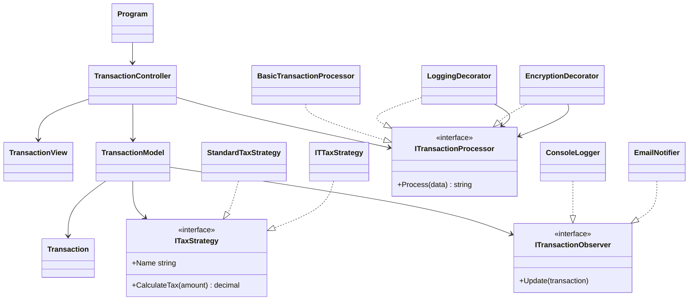

# Financial Transaction Monitor

Простий консольний C#-проєкт для демонстрації MVC та патернів Strategy, Decorator і Observer.

## Запуск

Потрібен .NET 8 SDK.

```text
dotnet run
```

Програма попросить ввести суму, виконає розрахунок зі стандартною ставкою 18%, а потім змінить стратегію на IT-ставку 5% і перерахує ту саму суму.

## Структура

```text
FinancialTransactionMonitor/
├── Controllers/TransactionController.cs
├── Decorators/
│   ├── ITransactionProcessor.cs
│   ├── BasicTransactionProcessor.cs
│   ├── LoggingDecorator.cs
│   └── EncryptionDecorator.cs
├── Models/
│   ├── Transaction.cs
│   └── TransactionModel.cs
├── Observers/
│   ├── ITransactionObserver.cs
│   ├── ConsoleLogger.cs
│   └── EmailNotifier.cs
├── Strategies/
│   ├── ITaxStrategy.cs
│   ├── StandardTaxStrategy.cs
│   └── ITTaxStrategy.cs
├── Views/TransactionView.cs
└── Program.cs
```

## Mermaid UML



## Пояснення патернів

### MVC

- **Model**: `TransactionModel` і `Transaction` містять дані та бізнес-логіку.
- **View**: `TransactionView` читає суму та показує результат у консолі.
- **Controller**: `TransactionController` отримує введення через View, запускає Model і передає результат назад у View.

### Strategy

`ITaxStrategy` описує спільний метод розрахунку податку. `StandardTaxStrategy` використовує 18%, а `ITTaxStrategy` 5%. Модель може отримати іншу стратегію через `SetTaxStrategy`, тому алгоритм змінюється під час роботи програми.

### Decorator

`BasicTransactionProcessor` виконує базову обробку. `EncryptionDecorator` додає кодування Base64, а `LoggingDecorator` додає логування. Декоратори можна комбінувати без зміни базового класу. Base64 тут використовується лише як проста демонстрація, а не як справжнє шифрування.

### Observer

Модель зберігає список `ITransactionObserver`. Після кожної транзакції вона викликає `Update` у `ConsoleLogger` та `EmailNotifier`. У реальній системі EmailNotifier міг би відправляти справжній лист.

## Як пояснити викладачу

1. Користувач вводить суму у View.
2. Controller передає її Model.
3. Model використовує поточну Strategy і рахує податок.
4. Результат проходить через ланцюжок Decorator: логування та кодування.
5. Model повідомляє всіх Observer.
6. Controller змінює StandardTaxStrategy на ITTaxStrategy і запускає розрахунок ще раз.

Головна перевага прикладу: щоб додати нову ставку, достатньо створити ще один клас Strategy; щоб додати нову дію над даними, можна створити ще один Decorator; щоб додати нове сповіщення, можна створити ще один Observer.
